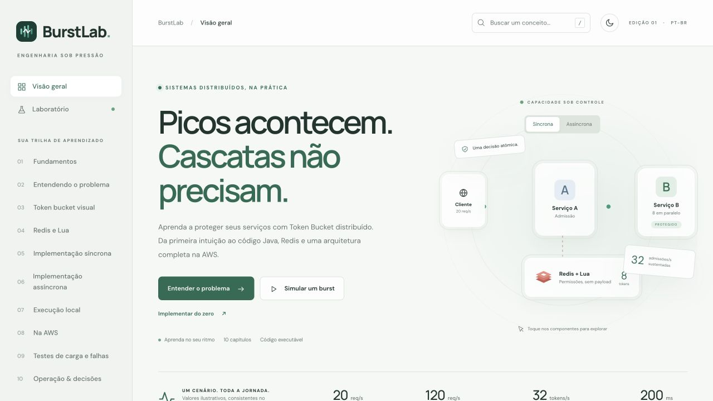

# BurstLab

Portal educacional interativo, em português do Brasil, sobre proteção contra bursts e falhas em cascata com Java, Redis, Lua e AWS.

**[Abrir o portal](https://wesleyvieira99.github.io/BurstLabTokenBucket/)** · **[Baixar o projeto Java](https://wesleyvieira99.github.io/BurstLabTokenBucket/burstlab-projeto.zip)** · **[Acompanhar a publicação](https://github.com/wesleyvieira99/BurstLabTokenBucket/actions/workflows/pages.yml)**



O GitHub Pages serve o portal, os capítulos, o simulador e os arquivos para download. **Java, Redis, PostgreSQL, SQS e workers precisam ser executados localmente ou na AWS.** Os indicadores do laboratório no navegador são uma simulação didática, sem conexão com o backend.

## Executar o portal localmente

Requer Python 3.10 ou superior. A partir da raiz deste repositório:

```bash
python3 scripts/build_portal.py
python3 -m http.server 4173 --directory portal/dist
```

Abra [localhost:4173](http://localhost:4173). O HTML/CSS/JavaScript não precisa de compilação; o script apenas atualiza o explorador `files.json`, o ZIP do projeto e `.nojekyll`. Use HTTP porque o explorador lê arquivos com `fetch`.

O pacote baixado pelo portal contém a pasta `burstlab-project/`. Os fontes também estão disponíveis, arquivo por arquivo, em [project/](project/).

## Executar os serviços Java

Com Docker e Docker Compose disponíveis:

```bash
cd project
docker compose up --build -d
docker compose ps
curl -fsS http://localhost:8080/actuator/health
```

O [README do projeto](project/README.md) explica pré-requisitos, endpoints, configuração, carga, falhas e limpeza. Consulte também o [roteiro AWS](project/docs/aws.md), o [runbook](project/docs/operations.md) e as [decisões arquiteturais](project/docs/decisions.md).

Java 17 LTS, Spring Boot 3.5.7 e Lettuce 6.6.0.RELEASE estão fixados no projeto. Redis guarda o estado de admissão; PostgreSQL mantém jobs, outbox, idempotência e a guarda transacional global de B; SQS transporta trabalhos.

## Testar

A partir da raiz, com Node.js 20 ou superior:

```bash
for file in portal/dist/*.js; do node --check "$file"; done
node --test portal/tests/simulator.test.cjs
python3 scripts/build_portal.py
```

Os nove testes do simulador são determinísticos. Para compilar e testar o backend, com Java 17 e Maven:

```bash
cd project
mvn verify
```

Os testes do Lua usam Redis real via Testcontainers quando Docker está ativo, ou `REDIS_TEST_URI` apontando para uma instância descartável. Não use Redis de produção. [VERIFICACAO.md](VERIFICACAO.md), [project/VERIFICATION.md](project/VERIFICATION.md) e [infra/VALIDATION.md](project/infra/VALIDATION.md) registram evidências e limitações das verificações originais.

## Organização

| Caminho | Conteúdo |
| --- | --- |
| [portal/dist/](portal/dist/) | Portal estático: capítulos, busca, temas, glossário, exercícios, simulador e calculadora |
| [portal/tests/](portal/tests/) | Testes do modelo da simulação |
| [project/](project/) | Serviços A/B, worker, biblioteca do limitador, Lua, Compose e Dockerfile |
| [project/infra/](project/infra/) | Terraform, testes mockados e scripts AWS |
| [project/docs/](project/docs/) | Guia AWS, fontes, runbook e decisões |
| [scripts/build_portal.py](scripts/build_portal.py) | Geração dos arquivos de download a partir dos fontes atuais |
| [.github/workflows/pages.yml](.github/workflows/pages.yml) | Verificação e publicação automática no GitHub Pages |

## Atualizar e publicar

Edite os capítulos em `portal/dist/content.js`, a interface em `index.html`, `styles.css` e `app.js`, ou o modelo em `simulator.js`. Para mudar a implementação, edite os arquivos em `project/`; não edite manualmente o conteúdo de `files.json` ou do ZIP.

Depois de uma alteração em `project/`, execute `python3 scripts/build_portal.py` para atualizar também a prévia local e inclua os arquivos gerados no commit. O gerador preserva o formato do explorador e cria um ZIP determinístico com todos os fontes elegíveis. Exclui diretórios de build/cache, estado Terraform, configurações pessoais e nomes conhecidos de credenciais; arquivos `.tfvars.example` e `.terraform.lock.hcl` são preservados. Essa seleção por nomes não substitui revisar o conteúdo antes de publicá-lo.

Cada push em `main` dispara o workflow do Pages. Também é possível executá-lo por **Run workflow** na página de Actions. O workflow verifica a sintaxe JavaScript, executa os nove testes, regenera os downloads e publica somente `portal/dist/`. As actions oficiais estão fixadas por SHA; o job de build tem leitura de conteúdo, e apenas o job de deploy recebe permissão de publicação Pages. Ele não executa Java, não acessa credenciais AWS e não provisiona infraestrutura.

## Premissas e limites

Entrada normal de **20/s**, burst de **120/s por 10 s**, B com **200 ms** e **8 slots globais**: capacidade teórica próxima de 40/s sob essas hipóteses. O bucket usa **C = 8** e **r = 32 tokens/s**, deixando margem. Concorrência e vazão são limites diferentes. Redis indisponível bloqueia novas admissões: política *fail-closed*.

A infraestrutura AWS não foi provisionada durante a criação do laboratório. Ela tem custos e fronteiras de produção explicitadas no roteiro; não inclui autenticação de tenants, garantia de justiça entre fluxos ou certificação de capacidade. O portal distingue simulação, cálculos e resultados observados. As referências oficiais estão junto às afirmações e em [project/docs/references.md](project/docs/references.md).
